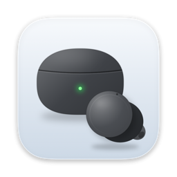
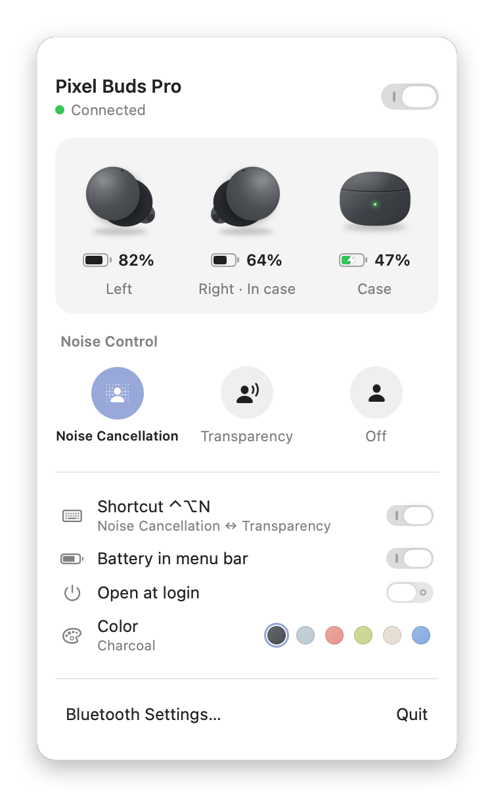
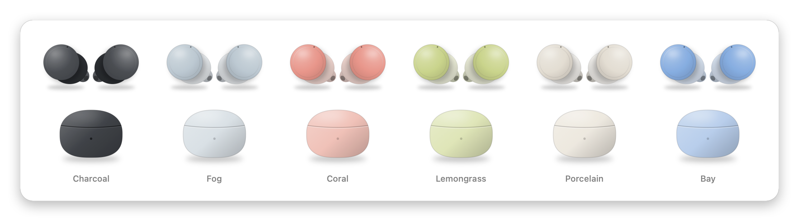
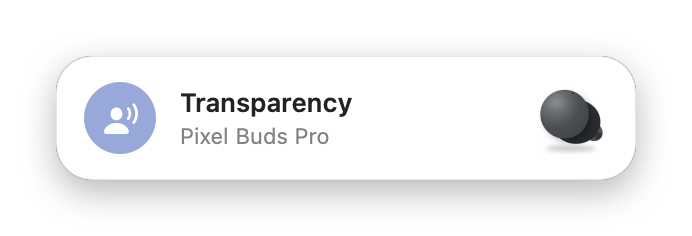

<p align="center">
  
</p>

<h1 align="center">BudsBar</h1>

<p align="center">
  <b>Pixel Buds Pro, right in your Mac's menu bar.</b><br>
  Battery for each bud and the case, noise control, and a global shortcut.
</p>

<p align="center">
  <a href="https://github.com/houqai/BudsBar/releases/latest"></a>
  
  
  <a href="LICENSE"></a>
</p>

<p align="center">
  <picture>
    <source media="(prefers-color-scheme: dark)" srcset="docs/panel-dark.png">
    
  </picture>
</p>

macOS treats Pixel Buds like any other headset: one vague battery number and no way to change noise control.
BudsBar talks to the buds directly, the same way the Pixel Buds app on Android does, and puts everything in one small panel.

## Features

- **Per-device battery.** Left bud, right bud and the case, with charging state and in-case detection.
- **Noise control.** Switch between Noise Cancellation, Transparency and Off in one click. Changes made with a gesture on the buds show up instantly.
- **Global shortcut.** <kbd>⌃</kbd> <kbd>⌥</kbd> <kbd>N</kbd> toggles Noise Cancellation ↔ Transparency from any app, with a small on-screen banner.
- **Menu bar at a glance.** A Pixel Buds Pro glyph with the charge of the buds you're wearing.
- **Connect / disconnect** without opening System Settings.
- **Your colour.** The artwork comes in all six Pixel Buds Pro colourways: Charcoal, Fog, Coral, Lemongrass, Porcelain and Bay.
- **Native and light.** SwiftUI, a single small universal binary, no dependencies, launch at login.

<p align="center">
  <picture>
    <source media="(prefers-color-scheme: dark)" srcset="docs/colorways-dark.png">
    
  </picture>
</p>

## Install

1. Download **BudsBar-x.y.z.zip** from the [latest release](https://github.com/houqai/BudsBar/releases/latest) and unzip it.
2. Move **BudsBar.app** to your Applications folder and open it.
3. When macOS asks, allow BudsBar to use **Bluetooth**.

> [!NOTE]
> BudsBar isn't notarized by Apple, so the first launch is blocked by Gatekeeper.
> Open **System Settings → Privacy & Security** and click **Open Anyway**, or run:
>
> ```sh
> xattr -dr com.apple.quarantine /Applications/BudsBar.app
> ```

Your Pixel Buds need to be paired with the Mac first (System Settings → Bluetooth).

## Usage

Click the earbud icon in the menu bar to open the panel.

| | |
|---|---|
| **Noise Control** | Pick a mode. The selected one is highlighted. |
| **Switch in the header** | Connects or disconnects the buds. |
| **<kbd>⌃</kbd> <kbd>⌥</kbd> <kbd>N</kbd>** | Toggles Noise Cancellation ↔ Transparency (Off switches to Noise Cancellation). Can be turned off in the panel. |
| **Battery in menu bar** | Shows the lowest charge among the buds you're wearing. |
| **Color** | Matches the artwork to your buds. |

<p align="center">
  <picture>
    <source media="(prefers-color-scheme: dark)" srcset="docs/hud-dark.png">
    
  </picture>
</p>

The case reports its battery only while at least one bud is inside it. The case itself has no Bluetooth radio.

## Build from source

Requires macOS 13 or later and the Xcode Command Line Tools (`xcode-select --install`).

```sh
git clone https://github.com/houqai/BudsBar.git
cd BudsBar
./build.sh --install     # builds, copies to ~/Applications and launches
```

| Command | What it does |
|---|---|
| `./build.sh` | Build for this Mac into `build/` |
| `./build.sh --install` | Build, install to `~/Applications` and launch |
| `./build.sh --release` | Universal build, zipped into `dist/` |
| `./scripts/screenshots.sh` | Re-render the images in `docs/` with sample data |
| `./scripts/make-icon.sh` | Re-render `Resources/AppIcon.icns` |
| `build/BudsBar.app/Contents/MacOS/BudsBar --selftest` | Check the protocol encoder against known test vectors |

Builds are ad-hoc signed, so macOS asks for Bluetooth access again after each rebuild.

## How it works

Pixel Buds Pro expose a proprietary RFCOMM service called **Maestro** (UUID `25e97ff7-24ce-4c4c-8951-f764a708f7b5`).
Messages are [Pigweed RPC](https://pigweed.dev/pw_rpc/) packets encoded as protobuf and wrapped in HDLC frames.

BudsBar opens that channel with IOBluetooth, finds the RPC channel that answers `GetSoftwareInfo`, and then:

- subscribes to `SubscribeRuntimeInfo` for battery levels and bud placement,
- subscribes to `SubscribeToSettingsChanges` and reads `CurrentAncrState` for the noise-control mode,
- writes `CurrentAncrState` to change the mode.

```
Sources/
├── Protocol.swift    HDLC framing, Pigweed RPC, protobuf, Maestro messages
├── Buds.swift        Bluetooth: finding the buds, RFCOMM link, reconnection
├── UI.swift          Menu bar panel, banner, global shortcut
├── Art.swift         Vector artwork of the buds and case, menu bar glyph
├── BudsBarApp.swift  App entry point
├── Preview.swift     Renders screenshots and the app icon
└── SelfTest.swift    Protocol test vectors
```

## Compatibility

| Device | Status |
|---|---|
| Pixel Buds Pro | Supported |
| Pixel Buds Pro 2 | Untested. Adaptive mode is offered when the device name contains "Pro 2". |
| Other Pixel Buds | Not supported (no Maestro service) |

Firmware updates to the buds could change the protocol at any time.

## Troubleshooting

- **"Connected · syncing…" never finishes.** Quit and reopen BudsBar, or turn the buds off and on again. Details are logged to `~/Library/Logs/BudsBar.log`.
- **Nothing happens on launch.** Check that BudsBar is allowed under System Settings → Privacy & Security → Bluetooth.
- **The shortcut doesn't work.** Another app may already use <kbd>⌃</kbd> <kbd>⌥</kbd> <kbd>N</kbd>.

## Privacy

BudsBar talks only to your earbuds over Bluetooth. It makes no network connections and collects no data.

## Acknowledgements

The Maestro protocol was reverse-engineered by [qzed/pbpctrl](https://github.com/qzed/pbpctrl), a Linux command-line tool for Pixel Buds Pro.
BudsBar's protocol layer is adapted from it. See [THIRD_PARTY_NOTICES.md](THIRD_PARTY_NOTICES.md).

## License

[MIT](LICENSE)

---

<sub>BudsBar is an independent project and is not affiliated with or endorsed by Google. Pixel and Pixel Buds are trademarks of Google LLC.</sub>
